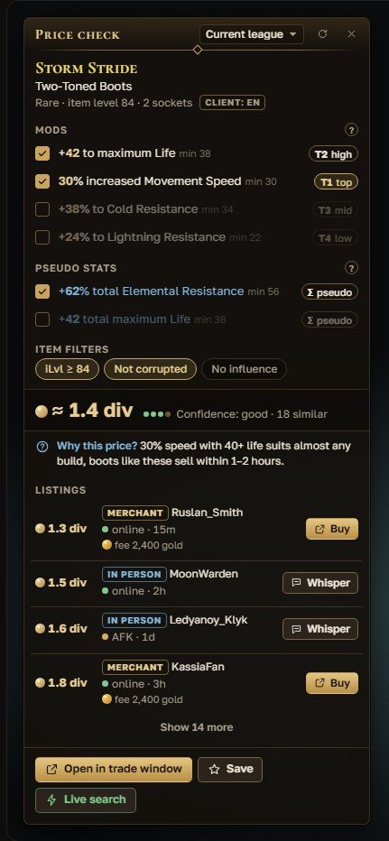
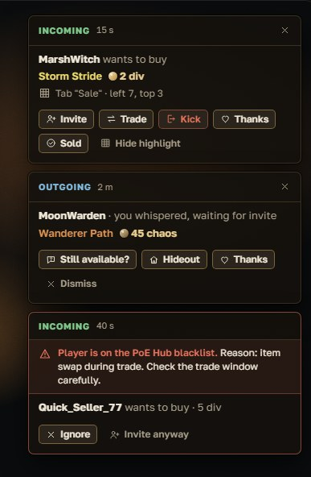
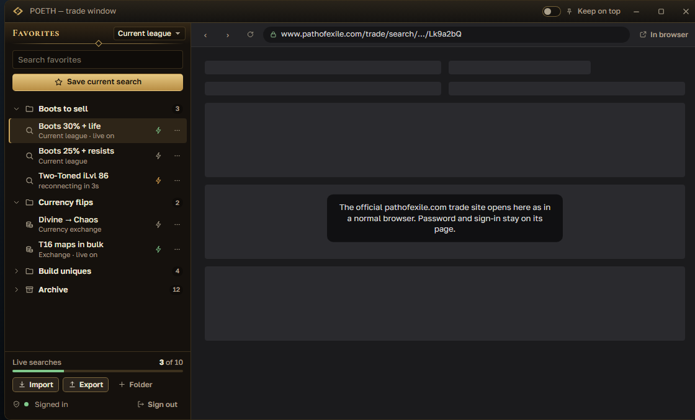
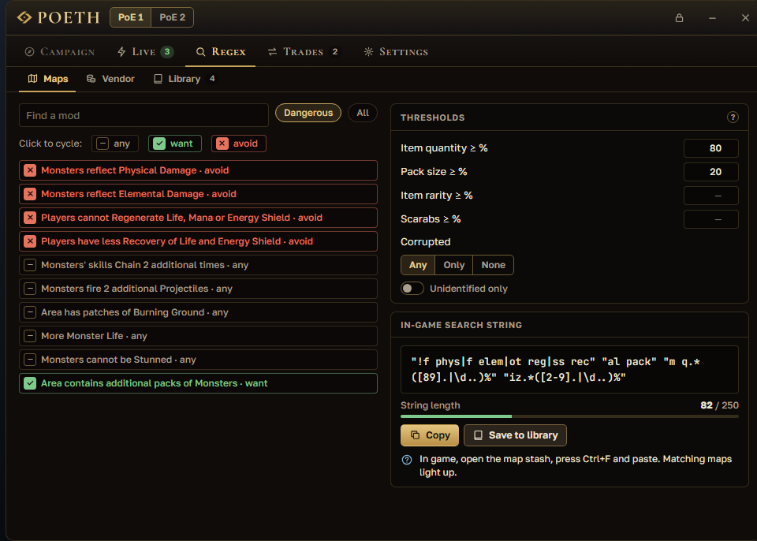

<a href="README.md">Русский</a> · <b>English</b>

<h1 align="center">
   
  POE Trade Helper (POETH)
</h1>

A helper for Path of Exile 1 and 2 on top of the game: hover an item, press <code>Ctrl+D</code> and see a fair price. Trading, currency exchange, wealth tracking and a leveling guide — in one app.

  
  
  
  

<h2 align="center"><a href="https://github.com/MAYZOSUPER/POETH/releases/latest">⬇ Download for Windows</a></h2>

<b><a href="https://mayzosuper.github.io/POETH/guide/?lang=en">Guide to every feature</a></b> — how to use each feature, step by step · <a href="docs/FAQ.en.md">FAQ</a>

## How to install

1. Download **`POETH-Setup-<version>.exe`** from the [latest release](https://github.com/MAYZOSUPER/POETH/releases/latest).
2. Run it and click “Next” — POETH installs into your user folder, no administrator rights needed.
3. Keep “Run POETH” checked: the first-run wizard helps you pick the language and the game. Set the game to
   **Windowed** or **Windowed Fullscreen**.

Windows showed “Windows protected your PC”? Click **“More info” → “Run anyway”**.

No install: `POETH-Portable-<version>.exe` runs right away; download new versions yourself.

Something not working? See the [FAQ](docs/FAQ.en.md).

## Features

How to use each feature step by step — see the [guide on the website](https://mayzosuper.github.io/POETH/guide/?lang=en).

<table>
  <tr>
    <td align="center" width="50%"> Price check at the cursor</td>
    <td align="center" width="50%"> Trade cards over the game</td>
  </tr>
  <tr>
    <td align="center"> Trade window with favorites</td>
    <td align="center"> Regex strings for your stash</td>
  </tr>
</table>

Pictures are from the UI mockups; in-game screenshots will come later.

### Trade

- **Item price with `Ctrl+D`.** The window opens at the cursor and tells you what to do with the item: sell it
  to a vendor in town, save it up to sell in bulk, or list it for ~X — copy the price note with one button.
- **Rare items are searched precisely:** on the same base, with the valuable mods (life, resistances, speed…)
  already checked. “Market price” shows the cheapest similar listings, without bait.
- **Currency is priced by the exchange rate at Faustus** (hourly GGG data), not by trade-site listings that
  often go stale.
- **In-game trade window** (`Ctrl+Shift+T`) — the official trade site plus your favorites: folders, Better Trading import.
- **Live search** — new listings pop up over the game; “Whisper” pastes the message to the seller into chat.
  Needs an account sign-in.
- **Trade manager:** incoming and outgoing trade cards, stash cell highlight, PoE Hub blacklist.
- **Currency exchange (flipping):** what is worth buying and selling at Faustus — at realistic buy and sell
  prices, with the gold fee. Read the “Market Ratio” table straight from the screen with `Alt+D` (beta).

### Farming

- **Wealth:** what your stash is worth and what you gained since last time. Needs an account sign-in; the stash
  is only read.
- **Map tracker:** maps, time and deaths from the game log, maps per hour; together with Wealth — income per hour.
- **Regex strings** for stash and vendor search: map mods, item properties at vendors (life, resistances,
  speed, gem levels…), your own string library on hotkeys.

### Leveling

- **PoE 1 leveling guide** over the game (`Ctrl+Shift+G`): the route act by act; the step moves on by itself
  when you enter a new zone.

### For everyone

- **English and Russian game client.** Item and currency names follow the game's language, explanations follow
  the interface language; you pick each one separately.
- **A simple mode for newcomers** with hints, and an expert mode with tiers and numbers.
- **Chat commands on hotkeys:** `F5` — hideout, your own commands and `@last` — the last person you talked to.
- **Updates:** the installed version updates itself; new league data arrives without reinstalling.
- **PoE 2:** campaign tracker (quests, rewards, zone layouts, “What's next?”) and item price with `Ctrl+D`.

Coming soon: “What to farm” — farming strategies with income per hour.

## Safety

- Open source: everything POETH does is in this repository.
- You sign in only on the official GGG page inside the trade window; the app never sees or stores your password.
- Your data goes nowhere. No bots, auto-buying or auto-messages: one player action — one app action.

Official builds are only on this repository's [releases page](https://github.com/MAYZOSUPER/POETH/releases).

What POETH stores and which sites it talks to, in detail — [docs/security.md](docs/security.md).

## Development

Build, checks and releasing — [docs/DEVELOPMENT.md](docs/DEVELOPMENT.md).

## Acknowledgments

- [Awakened PoE Trade](https://github.com/SnosMe/awakened-poe-trade) (MIT) — item parser, price-check filters and mod data.
- [RePoE](https://github.com/repoe-fork/repoe-fork) — open game data for regex strings.
- [Exile-UI](https://github.com/Lailloken/Exile-UI) (MIT) — PoE 2 campaign zone layouts.
- [exile-leveling](https://github.com/HeartofPhos/exile-leveling) (MIT) — the PoE 1 leveling guide route.
- [tesseract.js-core](https://github.com/naptha/tesseract.js-core) (Apache 2.0) — reading the digits of the “Market Ratio” table.
- [Better Trading](https://github.com/exile-center/better-trading) (MIT) — favorites import/export format.
- [PoE Hub / ForbiddenTroveBlacklist](https://github.com/The-Forbidden-Trove/ForbiddenTroveBlacklist) (MIT) — trade blacklist.

Details — [NOTICE.md](NOTICE.md). POETH is licensed under [MIT](LICENSE), © POETH contributors.

## Support the project

POETH is free and ad-free; you can support development on [Boosty](https://boosty.to/twistedthreadstudios) — a subscription unlocks nothing, everything is for everyone.

---

POE Trade Helper is an unofficial fan-made tool, not affiliated with or endorsed by Grinding Gear Games; Path of Exile and all assets © Grinding Gear Games.
