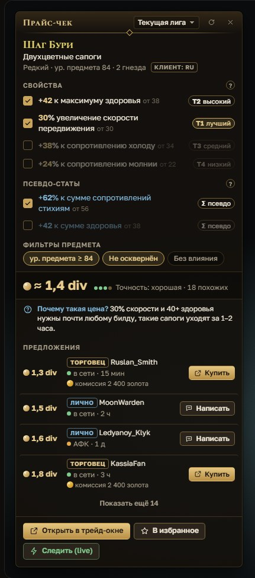
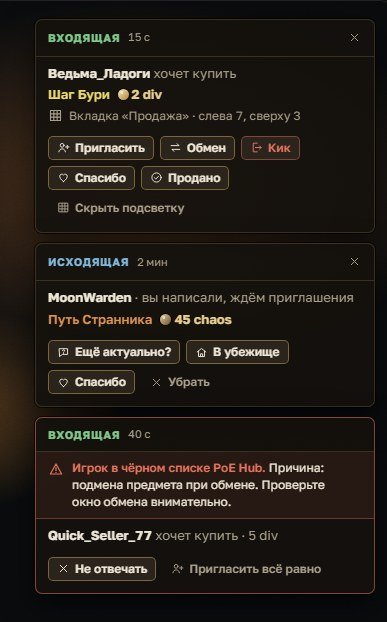
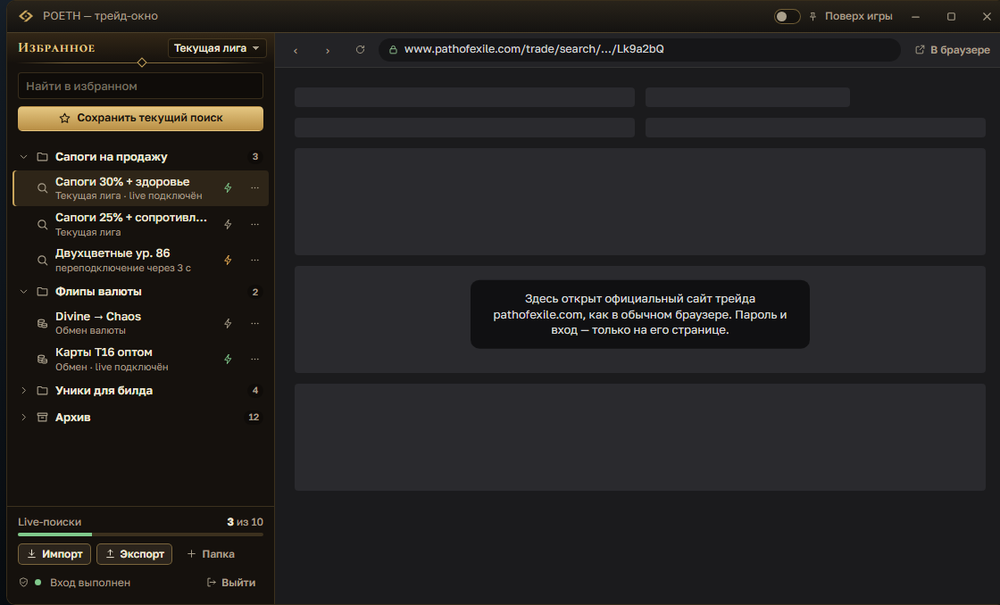
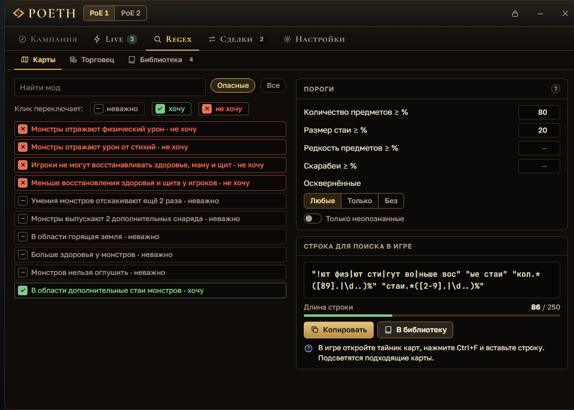

<b>Русский</b> · <a href="README.en.md">English</a>

<h1 align="center">
   
  POE Trade Helper (POETH)
</h1>

Помощник для Path of Exile 1 и 2 поверх игры: наведите курсор на предмет, нажмите <code>Ctrl+D</code> — и увидите честную цену. Трейд, обмен валюты, учёт богатства и гид прокачки — в одном приложении.

  
  
  
  

<h2 align="center"><a href="https://github.com/MAYZOSUPER/POETH/releases/latest">⬇ Скачать для Windows</a></h2>

## Как установить

1. Скачайте **`POETH-Setup-<версия>.exe`** со страницы [последнего релиза](https://github.com/MAYZOSUPER/POETH/releases/latest).
2. Запустите его и нажмите «Далее» — POETH встанет в вашу папку пользователя, права администратора не нужны.
3. Оставьте галочку «Запустить POETH»: мастер первого запуска поможет выбрать язык и игру. В игре включите
   режим **«Окно»** или **«Окно без рамки»**.

Windows показал «Система Windows защитила ваш компьютер»? Нажмите **«Подробнее» → «Выполнить в любом случае»**.

Без установки — `POETH-Portable-<версия>.exe`: запускается сразу, новые версии скачиваются вручную.

Что-то не работает? Загляните в [частые вопросы](docs/FAQ.md).

## Возможности

<table>
  <tr>
    <td align="center" width="50%"> Окно цены у курсора</td>
    <td align="center" width="50%"> Карточки сделок поверх игры</td>
  </tr>
  <tr>
    <td align="center"> Трейд-окно с избранным</td>
    <td align="center"> Regex-строки для тайника</td>
  </tr>
</table>

Картинки — из макетов интерфейса; скриншоты из игры появятся позже.

### Торговля

- **Цена предмета по `Ctrl+D`.** Окно появляется у курсора и подсказывает, что делать с вещью: продать торговцу
  в городе, копить на продажу пачкой или выставить за ~X — заметку цены можно скопировать одной кнопкой.
- **Редкие предметы ищутся точно:** по той же базе, а ценные свойства (жизнь, сопротивления, скорость…) уже
  отмечены. «Цена на рынке» — самые дешёвые похожие лоты, без приманок.
- **Валюта — по курсу обмена у Фаустуса** (почасовые данные GGG), а не по объявлениям на сайте, которые часто
  устаревают.
- **Трейд-окно прямо в игре** (`Ctrl+Shift+T`) — официальный сайт трейда и ваше избранное: папки, импорт из Better Trading.
- **Live search** — новые лоты приходят уведомлением поверх игры, «Написать» вставляет сообщение продавцу в чат.
  Нужен вход в аккаунт.
- **Менеджер сделок:** карточки входящих и исходящих сделок, подсветка ячейки тайника, чёрный список PoE Hub.
- **Обмен валюты (флиппинг):** что выгодно купить и продать у Фаустуса — по реальной цене покупки и продажи,
  с комиссией в золоте. Таблицу «Рыночный курс» можно считать прямо с экрана по `Alt+D` (бета).

### Фарм

- **Богатство:** сколько стоит ваш тайник и что прибавилось с прошлого раза. Нужен вход в аккаунт, тайник
  только читается.
- **Трекер карт:** карты, время и смерти по журналу игры, карт в час; вместе с «Богатством» — доход в час.
- **Regex-строки** для поиска в тайнике и у торговца: моды карт, свойства предметов у торговца (жизнь,
  сопротивления, скорость, уровни камней…), своя библиотека строк на горячих клавишах.

### Прокачка

- **Гид прокачки PoE 1** поверх игры (`Ctrl+Shift+G`): маршрут по актам, шаг меняется сам, когда вы входите
  в новую зону.

### Для всех

- **Русский и английский клиент игры.** Названия предметов и валют — на языке игры, пояснения — на языке
  интерфейса; оба языка выбираются отдельно.
- **Простой режим для новичков** с подсказками и экспертный — с тирами и цифрами.
- **Команды чата по клавишам:** `F5` — в убежище, свои команды и `@last` — последний собеседник.
- **Обновления:** установленная версия обновляется сама, данные новой лиги приходят без переустановки.
- **PoE 2:** трекер кампании (квесты, награды, схемы зон, «Что дальше?») и цена предмета по `Ctrl+D`.

Скоро: «Что фармить» — стратегии фарма с доходом в час.

## Безопасность

- Открытый код: всё, что делает POETH, видно в этом репозитории.
- Вход в аккаунт — только на официальной странице GGG внутри трейд-окна; пароль приложение не видит и не хранит.
- Ваши данные никуда не уходят. Никаких ботов, авто-покупок и авто-сообщений: одно действие игрока — одно
  действие программы.

Официальные сборки — только на странице [релизов этого репозитория](https://github.com/MAYZOSUPER/POETH/releases).

Подробно о том, что POETH хранит и куда обращается, — [docs/security.md](docs/security.md).

## Разработка

Сборка, проверки и выпуск релиза — [docs/DEVELOPMENT.md](docs/DEVELOPMENT.md).

## Благодарности

- [Awakened PoE Trade](https://github.com/SnosMe/awakened-poe-trade) (MIT) — парсер предметов, фильтры прайс-чека и данные модов.
- [RePoE](https://github.com/repoe-fork/repoe-fork) — открытые данные игры для regex-строк.
- [Exile-UI](https://github.com/Lailloken/Exile-UI) (MIT) — лейауты зон кампании PoE 2.
- [exile-leveling](https://github.com/HeartofPhos/exile-leveling) (MIT) — маршрут гида прокачки PoE 1.
- [tesseract.js-core](https://github.com/naptha/tesseract.js-core) (Apache 2.0) — распознавание цифр таблицы «Рыночный курс».
- [Better Trading](https://github.com/exile-center/better-trading) (MIT) — формат импорта и экспорта избранного.
- [PoE Hub / ForbiddenTroveBlacklist](https://github.com/The-Forbidden-Trove/ForbiddenTroveBlacklist) (MIT) — чёрный список для сделок.

Подробно — в [NOTICE.md](NOTICE.md). Лицензия POETH — [MIT](LICENSE), © POETH contributors.

## Поддержать проект

POETH бесплатный и без рекламы; поддержать разработку можно на [Boosty](https://boosty.to/twistedthreadstudios) — подписка не открывает функций, всё доступно каждому.

---

POE Trade Helper — неофициальный фанатский инструмент, не связан с Grinding Gear Games и не одобрен ими; Path of Exile и все ассеты © Grinding Gear Games.
